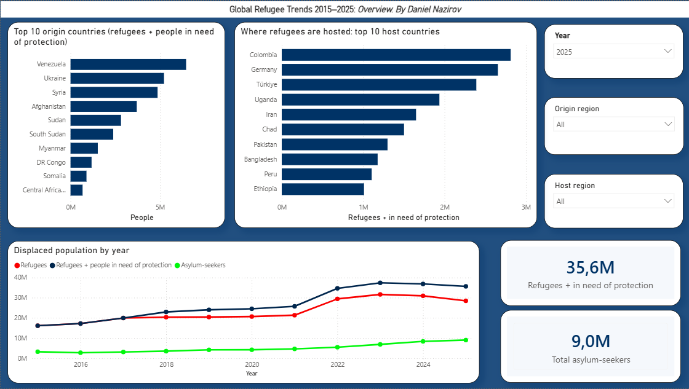
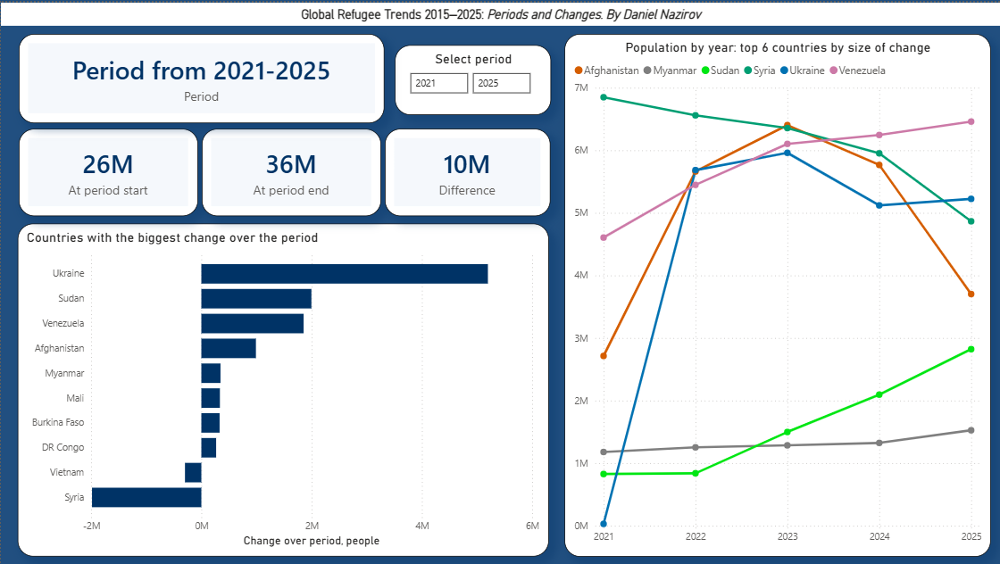

# Global Refugee Trends 2015–2025

Python data pipeline and 2-page Power BI dashboard built on official UNHCR statistics.
Capstone project, AI Academy (Kyrgyzstan), 2026.




## Key findings
- 35.6 million refugees and people in need of international protection at the end of 2025 (16 million in 2015), plus 9.0 million asylum-seekers.
- Three distinct mechanisms behind the changes:
  - **Sudden wars:** Ukraine grew from 28K (2021) to 5.7M (2022); Sudan grew from 2023 to 2.8M.
  - **Crisis without war:** Venezuela grew from 4.6M (2021) to 6.5M (2025) with no single-year spike (refugees + others in need of protection).
  - **Returns and counting:** Afghanistan rose from 2.7M to 5.7M in 2022 (new arrivals and improved registration), then fell from 5.8M to 3.7M in 2025 after 2.9M returns; Syria fell to 4.9M after December 2024.
- Causes are taken from the [UNHCR Global Trends 2025](https://www.unhcr.org/sites/default/files/2026-06/global-trends-report-2025.pdf) report, not derived from the dataset.

## Data
- Source: [UNHCR Refugee Data Finder](https://www.unhcr.org/refugee-statistics/) (asylum applications; population figures), 2015–2025.
- Raw input: 123,668 rows in two files. Output: four tables, 100,711 rows (`data/processed/`).

## Pipeline (`src/refugees_pipeline_en.py`)
- Keeps new applications counted in persons; separates IDPs (origin = asylum country) from cross-border refugees.
- Assigns regions and a Europe group (EU-27, EFTA + UK, ...); fixes edge cases (Cyprus, Sint Maarten, Türkiye).
- Converts US asylum "cases" to persons using UNHCR footnote factors, so countries are comparable.
- Automated checks: cleaned totals must equal raw-file totals.

```bash
pip install pandas pycountry-convert babel
python src/refugees_pipeline_en.py --asylum asylum_applications.csv --pop persons_of_concern.csv --out data/processed
```

## Dashboard (`dashboard/global-refugee-trends.pbix`, preview: `dashboard/global-refugee-trends.pdf`)
- **Overview:** headline numbers, top-10 origin and host countries, population by year; slicers for year, origin region and host region.
- **Periods and changes:** Between slicer for any year range, start/end/change cards, countries with the biggest change, population trends for the top 6.
- DAX uses a Years dimension table and end-of-period measures: stocks are never summed across years.

## Limitations
- 2025 data may be incomplete; internally displaced people (IDPs) are excluded from the analysis.
- Absolute numbers, not per-capita: population data is not in the dataset.
- Causes come from UNHCR reports; the data shows when and how much, not why.
- Venezuela's jump between 2017 and 2018 is partly a reporting artifact: the "other people in need of international protection" category has no values before 2018 in this dataset. Period comparisons that start before 2018 overstate Venezuela's growth.

## Notes
Built with AI assistance (Claude) for code drafting and review; all outputs were validated against raw UNHCR totals.
